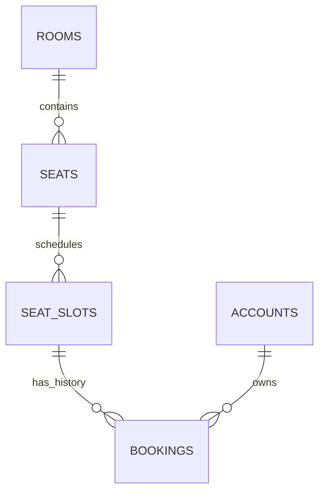

# 从源码到面试

## 先跑起来，再沿一条请求读代码

1. **完整走一遍预约。** 用管理员开放时段，再用学生账号提交预约。打开 Swagger 查看响应 JSON，找出 `slotId`、预约 `id` 和 `canCancel`。
2. **读一个简单查询。** 从 `RoomController.slots()` 跟到 `RoomService.readSlots()`，对照 SQL 中的 `seats`、`seat_slots` 和 `bookings`。试着自己给座位列表加一个只显示可预约座位的参数，并在 API 测试中覆盖有空位和无空位的情况。
3. **跟一次写入。** 从 `BookingController.create()` 跟到 `BookingService.create()`。先看校验时间的分支，再打开 `V1__schema.sql`，找出数据库里实际拒绝重复写入的两个唯一约束。
4. **理解登录和权限。** `AuthService` 负责核验密码、签发带角色和用户 ID 的 JWT，`SecurityConfig` 配置验签和角色限制。个人记录的用户 ID 来自通过验证的 token，创建请求只接收 `slotId`。
5. **自己加一个需求。** 例如实现管理员导出某日预约列表。增加管理员权限测试、日期过滤和索引分析，保留一条独立提交。面试时用它讲你亲手完成的需求与调试过程。

## 数据关系

| 文件 | 阅读重点 |
| --- | --- |
| `src/main/resources/db/migration/V1__schema.sql` | 主外键、预约不变量、分页索引 |
| `src/main/java/io/seatbook/booking/BookingService.java` | 插入、游标分页、取消事务 |
| `src/main/java/io/seatbook/booking/RoomService.java` | 批量放号、查询座位状态 |
| `src/main/java/io/seatbook/booking/ScheduleRules.java` | 时间窗口、时区、起始边界 |
| `src/main/java/io/seatbook/config/SecurityConfig.java` | JWT 验证、角色限制 |
| `src/test/java/io/seatbook/SeatbookIT.java` | 从 HTTP 请求验证数据库和业务行为 |

## 面试中可以讲清的三个决策

**如何防止超卖？** 查询界面上的可用状态只是快照。写入时让 MySQL 用两个唯一索引判定冲突：一个限制座位时段，另一个限制用户、日期和时段。并发插入由 InnoDB 保证唯一性，Java 将重复键异常转换为 HTTP 409。逻辑对多个应用实例同样成立。用真实 MySQL 的并发测试证明行为，而不是拿接口单次成功当并发证据。

**为什么取消不删记录？** 取消在事务中以当前用户身份锁住自己的预约行，写入取消时间。两个生成列随之变成 `NULL`，释放唯一键，同时保留历史。重试取消时直接返回已有结果。MySQL 唯一索引允许多个 `NULL`，所以同一座位能积累多条取消记录。

**为什么用游标分页？** 个人历史按预约 ID 倒序查询，使用 `(user_id, id)` 索引。下一页只拿 ID 小于上次最后一条的位置，新预约插到第一页时不会把旧记录推到后续页面造成重复。这个方案适合「加载更多」，不提供任意页跳转。

项目中的自习室与座位由迁移脚本提供，时段固定。JWT 采用短期访问令牌，退出会清空当前页面令牌，已签发令牌在过期前不做服务端吊销。源码中没有 Redis 或消息队列依赖。预约的强一致约束由关系数据库提供，需求扩展时可以先测热点时段的写入冲突与吞吐量。

## 简历表述示例

在你独立跑通并完成自己的改动后，可以按实际贡献写：

> 校园自习室预约系统（Java、Spring Boot、MySQL）。实现学生预约、取消、个人历史和管理员放号；利用 InnoDB 唯一约束处理并发冲突，使用真实 MySQL 集成测试验证 8 路并发下同一座位只生成一条有效预约。

接着补一条你自己的改动，写出解决的问题、验证方法和结果。

官方资料：[Spring Boot 环境要求](https://docs.spring.io/spring-boot/4.0/system-requirements.html) · [MySQL 生成列](https://dev.mysql.com/doc/refman/8.4/en/create-table-generated-columns.html) · [MySQL 唯一索引](https://dev.mysql.com/doc/refman/8.4/en/create-index.html)
