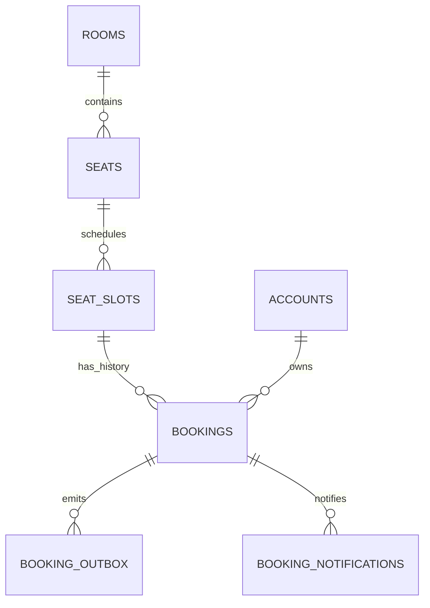
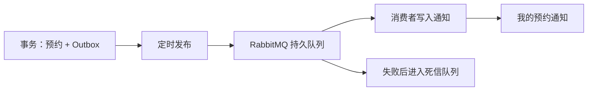
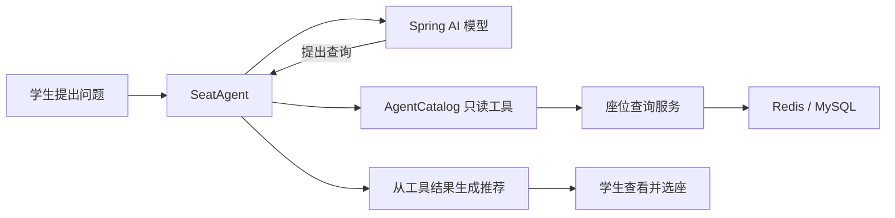

# 从源码到面试

## 先跑起来，再沿一条请求读代码

1. **完整走一遍预约。** 用管理员开放时段，再用学生账号提交预约。打开 Swagger 查看响应 JSON，找出 `slotId`、预约 `id` 和 `canCancel`。
2. **读一个简单查询。** 从 `RoomController.slots()` 跟到 `RoomService.readSlots()`，对照 SQL 中的 `seats`、`seat_slots` 和 `bookings`。试着自己给座位列表加一个只显示可预约座位的参数，并在 API 测试中覆盖有空位和无空位的情况。
3. **跟一次写入。** 从 `BookingController.create()` 跟到 `BookingService.create()`。先看校验时间的分支，再打开 `V1__schema.sql`，找出数据库里实际拒绝重复写入的两个唯一约束。
4. **理解登录和权限。** `AuthService` 负责核验密码、签发带角色和用户 ID 的 JWT，`SecurityConfig` 配置验签和角色限制。个人记录的用户 ID 来自通过验证的 token，创建请求只接收 `slotId`。
5. **跟一条异步通知。** 从 `BookingService.create()` 跟到 `BookingOutbox.recordCreated()`，再读 `OutboxDispatcher` 和 `NotificationConsumer`。在前端看通知何时出现，对照 RabbitMQ 管理台里的交换机和队列。
6. **跑一遍 Agent 工具调用。** 在 Swagger 请求 `/api/agent/ask`，观察 `mode`、`toolsUsed` 和 `options`。查看 `SeatAgentTest` 中本地模型服务如何接收工具调用结果。
7. **自己加一个需求。** 例如给通知增加已读状态和未读计数，覆盖用户隔离以及重复标记的行为，保留一条独立提交。

## 数据关系

| 文件 | 阅读重点 |
| --- | --- |
| `src/main/resources/db/migration/V1__schema.sql` | 主外键、预约不变量、分页索引 |
| `src/main/java/io/seatbook/booking/BookingService.java` | 插入、游标分页、取消事务 |
| `src/main/java/io/seatbook/booking/RoomService.java` | 批量放号、查询座位状态 |
| `src/main/java/io/seatbook/booking/ScheduleRules.java` | 时间窗口、时区、起始边界 |
| `src/main/java/io/seatbook/config/SecurityConfig.java` | JWT 验证、角色限制 |
| `src/main/java/io/seatbook/booking/SlotCache.java` | Redis 缓存、版本切换和降级 |
| `src/main/java/io/seatbook/notification/` | Outbox 发送、RabbitMQ 消费和通知查询 |
| `src/main/java/io/seatbook/agent/` | Spring AI 工具编排、本地解析、推荐生成 |
| `src/main/java/io/seatbook/booking/AgentCatalog.java` | 给 Agent 使用的只读业务入口 |
| `src/test/java/io/seatbook/SeatbookIT.java` | 真实 MySQL、Redis、RabbitMQ 集成验证 |

## 面试中可以讲清的三个决策

**如何防止超卖？** 查询界面上的可用状态只是快照。写入时让 MySQL 用两个唯一索引判定冲突：一个限制座位时段，另一个限制用户、日期和时段。并发插入由 InnoDB 保证唯一性，Java 将重复键异常转换为 HTTP 409。逻辑对多个应用实例同样成立。用真实 MySQL 的并发测试证明行为，而不是拿接口单次成功当并发证据。

**为什么取消不删记录？** 取消在事务中以当前用户身份锁住自己的预约行，写入取消时间。两个生成列随之变成 `NULL`，释放唯一键，同时保留历史。重试取消时直接返回已有结果。MySQL 唯一索引允许多个 `NULL`，所以同一座位能积累多条取消记录。

**为什么用游标分页？** 个人历史按预约 ID 倒序查询，使用 `(user_id, id)` 索引。下一页只拿 ID 小于上次最后一条的位置，新预约插到第一页时不会把旧记录推到后续页面造成重复。这个方案适合「加载更多」，不提供任意页跳转。

### Redis 如何避免缓存影响预约正确性

座位查询按「自习室、日期、时段」缓存 15 秒。放号、创建预约或取消的事务提交后，切换该键的缓存版本。写操作之前开始的查库请求只能补写旧版本，后续读取会使用新版本。过期、连接异常和空缓存都会回源 MySQL，时段开始前后的判断仍根据校区时间执行。Redis 故障或失效通知失败时，快照可能短暂过期；写入仍要经过 MySQL 唯一约束。

### RabbitMQ 如何可靠地送达预约通知

1. 预约或取消与 Outbox 事件在同一个 MySQL 事务里提交，事件带稳定的 `eventId`。
2. 定时任务用 `FOR UPDATE SKIP LOCKED` 领取待发送事件，在限时内等 RabbitMQ 发布确认。未确认或未路由的事件延后重试，最长间隔 60 秒。
3. 消费者按事件 ID 读取已提交的 Outbox 数据，在通知表用唯一键去重，提交成功后由监听容器确认消费。无效消息和重试耗尽的消息进入死信队列。

同一消息可能重复投递，例如 RabbitMQ 已确认但应用在标记 Outbox 前退出。消费者的唯一键保证同一事件只生成一条通知。当前实现适合单体演示，派发时短暂持有一条数据库行锁，聚合高吞吐场景时可比较「租约领取 + 事务外发送」。Outbox 保留供排查及重放，后续可按业务保留期归档。

用专门的演示环境验证降级时，可以在应用已启动后执行 `docker compose stop rabbitmq`，然后创建一条预约。预约会写入 MySQL，通知等待发送。执行 `docker compose start rabbitmq` 后观察通知出现。

项目中的自习室与座位由迁移脚本提供，时段固定。JWT 采用短期访问令牌，退出会清空当前页面令牌，已签发令牌在过期前不做服务端吊销。

## 简历表述示例

在你独立跑通并完成自己的改动后，可以按实际贡献写：

> 校园自习室预约系统（Java、Spring Boot、MySQL、Redis、RabbitMQ、Spring AI）。实现并发预约、缓存和可靠通知，使用 Spring AI 编排只读查询工具，根据真实余位生成自然语言检索的推荐卡片。

接着补一条你自己的改动，写出解决的问题、验证方法和结果。

官方资料：[Spring Boot 环境要求](https://docs.spring.io/spring-boot/4.0/system-requirements.html) · [MySQL 生成列](https://dev.mysql.com/doc/refman/8.4/en/create-table-generated-columns.html) · [MySQL 唯一索引](https://dev.mysql.com/doc/refman/8.4/en/create-index.html)

## Agent 如何查座位

工具只开放查询规则、列出自习室和查询可用座位。模型会返回工具名称与 JSON 参数。应用检查工具白名单、参数大小和调用次数，再执行查询，并将工具结果送回模型。用户看到的余位和推荐由服务器从查询结果生成。

预约按钮继续调用原有预约接口。就算两个人同时得到相同推荐，MySQL 仍只允许一条有效预约。当前助手每次请求独立处理，消息与工具结果只在这次调用中使用。没有密钥时运行本地规则解析；本地测试通过模拟 HTTP 服务来检验模型协议和降级。

官方资料：[Spring AI Tool Calling](https://docs.spring.io/spring-ai/reference/api/tools.html)
